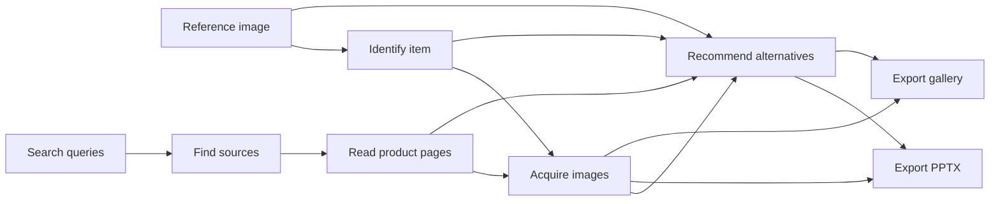

# Image sourcing with explicit exports

The executable example is [image-candidates.workflow.json](../examples/image-candidates.workflow.json).
It contains seven tasks. The reference image is an explicit artifact binding;
search queries are a run-time input. AI recommendations are advisory and do not
remove candidates from either export.

The two export nodes use registered operations in the existing runtime:

| Operation | Named inputs | Named output |
| --- | --- | --- |
| `images.pptx` | `photos`: acquired ZIP; `recommendations`: Markdown or text | `result`: PPTX |
| `images.gallery` | `photos`: acquired ZIP; `recommendations`: Markdown or text | `result`: HTML |

Each node owns its input checks, local conversion, limits and output receipt.
They have independent task status and exact input/output versions. A confirmed
PPTX failure does not invalidate a completed gallery. A fresh explicitly admitted
export can reuse the existing inputs without repeating research, image acquisition
or its successful sibling. Uncertain dispatched operations cannot be replayed.

The file delivery service copies exact registered outputs and lists their status.
It does not construct presentations or galleries. There is no handoff task or
hidden conversion between nodes. Older workflow files do not gain these nodes
automatically; their saved assignments and results remain historical.

Code validates file identity and media compatibility. It does not determine
visual suitability or infer user acceptance. Both exports retain all acquired
candidates, source links, missing-image outcomes and unknown buying details.

The new operations must be explicitly present in a prospective job's operation
grant. Existing jobs do not inherit new capabilities. Referencing a collected
worker file uses the existing job delivery ceiling; it is not new owner-authored
content. The smaller owner writing limit remains enforced.

The PPTX presents three image cards per slide. Full advisory text and unavailable
source records remain in slide notes; the gallery puts these details in expandable
sections below the cards. Document titles come from the supplied report heading.
New generic output copies use that title as a descriptive filename, while existing
published filenames remain stable. Internal port names stay `result`.
